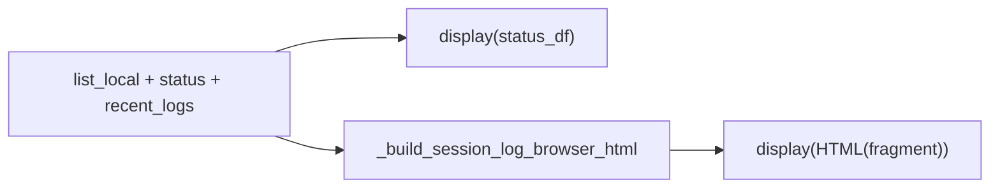

# Open session log browser in default web browser

## Problem

[`show_session_log_browser`](c:\Users\pho\repos\PhoGlobusHelpers\src\phoglobushelpers\gen_scripts_log_status.py) always renders via `display(HTML(_build_session_log_browser_html(...)))`. That avoids ipywidgets focus theft but still embeds a large widget in the notebook. You want an **opt-in path** to view the same UI in the **system default browser**, with **separate control** over whether the notebook still shows inline HTML.

## Current flow



`_build_session_log_browser_html` returns an **HTML fragment** (inline `<style>`, widget `<div>`, `<script>`) — not a full document. External browsers need a wrapped document and a `file://` URL.

## API changes ([`gen_scripts_log_status.py`](c:\Users\pho\repos\PhoGlobusHelpers\src\phoglobushelpers\gen_scripts_log_status.py))

Extend `show_session_log_browser` (replace unused `**kwargs` with explicit parameters):

| Parameter | Default | Behavior |
|-----------|---------|----------|
| `open_in_browser` | `False` | Write standalone HTML and call `webbrowser.open_new_tab(path.as_uri())` |
| `display_in_notebook` | `True` | When `True` and logs exist, keep `display(HTML(...))` |
| `browser_html_path` | `None` | Optional output path; if omitted, write under `%TEMP%` as `gen_scripts_log_browser_<utc_timestamp>.html` |

Docstring updates:

- Note that **browser mode** avoids notebook focus issues entirely when combined with `display_in_notebook=False`.
- Print the written path when opening (mirror [`build_globus_web_filemanager_url`](c:\Users\pho\repos\PhoGlobusHelpers\src\phoglobushelpers\path_helpers.py) messaging).
- On `webbrowser.Error`, print a short headless fallback message; HTML file path still printed.

**Notebook usage example** (optional comment in [`greatlakes_file_transfers_notebook.ipynb`](c:\Users\pho\repos\PhoGlobusHelpers\notebooks\greatlakes_file_transfers_notebook.ipynb) — not required unless you want it wired in the cell):

```python
status_df = show_session_log_browser(
    Path(r"K:/scratch/gen_scripts"),
    most_recent_only_log_file_df=most_recent_only_log_file_df,
    most_recent_n_logs=8,
    open_in_browser=True,
    display_in_notebook=False,
)
```

Return value stays **`status_df` only** (no API break).

## New helpers (same module)

1. **`_wrap_session_log_browser_document(html_fragment: str, *, title: str) -> str`**

   Minimal standalone shell:

   - `<!DOCTYPE html>`, `<meta charset="utf-8">`, viewport meta
   - `<title>` escaped
   - Light `body { margin: 8px; }` so standalone view is readable outside VS Code theme vars (existing CSS already has non-VS Code fallbacks)

2. **`_save_session_log_browser_html(html_fragment: str, *, path: Optional[Path]) -> Path`**

   - Wrap fragment, `write_text(..., encoding="utf-8")`
   - Create parent dirs if `browser_html_path` is provided

3. **`_open_html_in_default_browser(path: Path) -> None`**

   - `webbrowser.open_new_tab(path.resolve().as_uri())` with try/except (same pattern as `path_helpers.py`)

## Refactor display block (~1248–1251)

Build HTML **once** when `recent_logs` is non-empty:

```python
html_fragment = _build_session_log_browser_html(...)
if open_in_browser:
    out_path = _save_session_log_browser_html(html_fragment, path=...)
    print(f"Opening session log browser: {out_path}")
    _open_html_in_default_browser(out_path)
if display_in_notebook:
    display(HTML(html_fragment))
```

If both flags are `False` with logs present, still write nothing and show nothing (edge case; docstring can say at least one should be true).

## Tests

Add a small test in [`tests/test_gen_scripts_log_status_job_parse.py`](c:\Users\pho\repos\PhoGlobusHelpers\tests\test_gen_scripts_log_status_job_parse.py) or a new `tests/test_gen_scripts_log_browser_html.py`:

- `_wrap_session_log_browser_document` contains `<!DOCTYPE html>` and embeds fragment
- `_save_session_log_browser_html` writes UTF-8 file (tmpdir)
- Mock `webbrowser.open_new_tab` when testing `show_session_log_browser(..., open_in_browser=True, display_in_notebook=False)` with minimal fake `file_df` / monkeypatched builders if needed — **prefer unit-testing helpers only** to avoid heavy K: scan fixtures

## Out of scope

- Live auto-refresh in the browser tab
- HTTP server (file URL is sufficient for local logs + `vscode://` / `cursor://` open links already in the widget JS)
