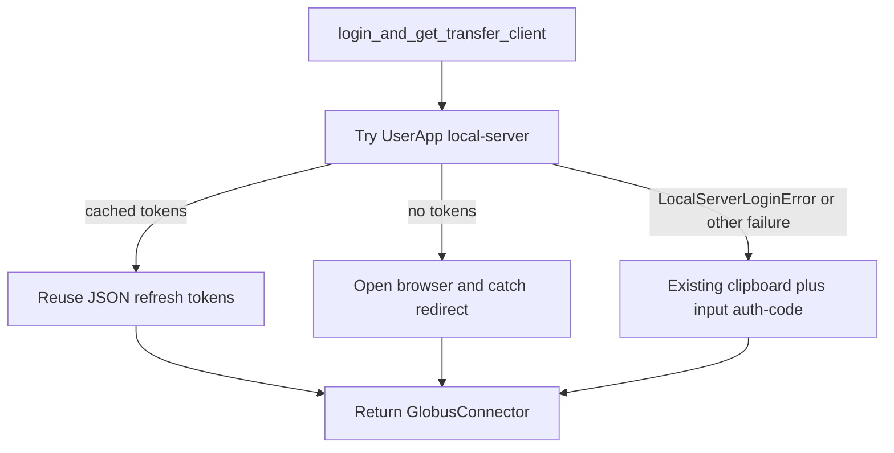

# Globus UserApp login with copy/paste fallback

## Problem

[`GlobusConnector.login_and_get_transfer_client()`](src/phoglobushelpers/PhoGlobusHelper.py) always runs a Native App auth-code grant: print URL, copy to clipboard, `input()` for the code. Refresh tokens are requested but never saved, so every notebook kernel restart repeats the Cursor prompt.

Locked SDK is **globus-sdk 3.45.0**. Stable `from globus_sdk import UserApp` starts at **3.46**.

## Approach

Keep the public API unchanged so notebooks (`connect_man = GlobusConnector.login_and_get_transfer_client()`) need no edits.

Primary path uses `UserApp` with:

- `login_flow_manager="local-server"` (opens browser, no URL/code paste)
- `token_storage="json"` (Windows: `%LOCALAPPDATA%\globus\app\{client_id}\PhoGlobusHelpers\tokens.json`)
- `request_refresh_tokens=True`

Fallback path is the **current** implementation (print URL, optional clipboard, `input()`), extracted to a helper. Do not catch `KeyboardInterrupt` / `SystemExit` into fallback.

Same native client ID: `769d24e1-d1cc-4198-9ff7-2626485da449`.

## Files

- [`pyproject.toml`](pyproject.toml): raise `globus-sdk` to `>=3.46.0,<4` so `UserApp` is a stable import. Re-lock with `uv lock` (bump `globus-cli` within `<4` only if the lock requires it).
- [`src/phoglobushelpers/PhoGlobusHelper.py`](src/phoglobushelpers/PhoGlobusHelper.py):
  - Split login into `_login_via_user_app(scopes)` and `_login_via_auth_code(scopes, copy_to_clipboard)` (today’s body).
  - `login_and_get_transfer_client` tries UserApp first, prints a one-line reason, then falls back.
  - Optional `app` field on `GlobusConnector` (default `None`) so `GlobusConnector(transfer_client=...)` callers such as [`scripts/globus_fuse_mount.py`](scripts/globus_fuse_mount.py) stay valid.
  - Parse the existing scopes string into UserApp `scope_requirements` / `add_scope_requirements` (including ConsentRequired `data_access` scopes).
  - Fix `list_files` ConsentRequired: today it assigns a `GlobusConnector` to `transfer_client` and never retries `operation_ls` (would `NameError`). After extra-scope login, set `self.transfer_client` (and `self.app` if present) and retry the listing.

Out of scope: FUSE `fair_research_login` path, automation-examples, and notebook cells (call site already correct).

## ConsentRequired

When UserApp succeeded, add the required scopes on `self.app` and call `app.login()` (browser or cache), then retry `operation_ls`. If login was the copy/paste fallback (`app is None`), call `login_and_get_transfer_client(scopes=required_scopes)` again, copy `.transfer_client` onto `self`, then retry.
