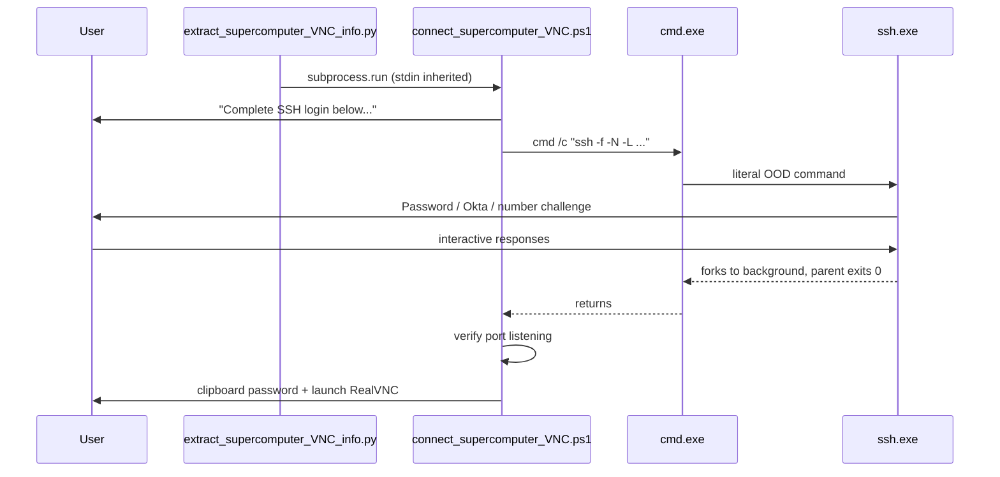

# Interactive SSH 2FA in Connect Script

## Root cause

The tunnel is started **detached and minimized**, so the user never sees or can answer the required login prompts:

```19:19:c:\Users\pho\repos\PhoWindowsHelpers\scripts\start_supercomputer_ssh_tunnel.cmd
start "GreatLakes VNC Tunnel" /min cmd /c "%~1"
```

[`connect_supercomputer_VNC.ps1`](c:\Users\pho\repos\PhoWindowsHelpers\scripts\connect_supercomputer_VNC.ps1) calls this via `Start-Process` (non-blocking), then immediately polls for the port with a 30s timeout. Meanwhile SSH is waiting for:

1. Password
2. Okta passcode / push
3. Number challenge ("The correct answer is 20")
4. Enter to continue

None of that is possible in a minimized background window, so `Wait-SshTunnelReady` always times out.

Your manual CMD run (terminal 9) works because stdin/stdout are attached to an interactive console.

## Chosen approach: synchronous login in the same terminal

Per your preference, run the literal SSH command **in the current console** and **block until auth completes** (`ssh -f` returns after daemonizing). No separate popup, no background race.



This matches the working manual workflow and avoids the timing problem entirely: the script does not proceed to VNC until SSH auth finishes.

## Implementation

### 1. Add `Start-SshTunnelInteractive` in helpers

In [`_supercomputer_VNC_tunnel_helpers.ps1`](c:\Users\pho\repos\PhoWindowsHelpers\scripts\_supercomputer_VNC_tunnel_helpers.ps1), add a function that runs the literal command synchronously:

```powershell
function Start-SshTunnelInteractive {
    param([string]$SshCommand)
    Write-Host ""
    Write-Host "=== SSH login required ==="
    Write-Host "Enter your password, then complete Okta 2FA (push/passcode + number challenge)."
    Write-Host "Command: $SshCommand"
    Write-Host ""
    & cmd.exe /c $SshCommand
    if ($LASTEXITCODE -ne 0) {
        Write-Error "SSH tunnel failed (exit code $LASTEXITCODE). Check credentials/VPN and retry."
        exit 1
    }
}
```

- Keep `Start-SshTunnelViaCmd` for optional detached/popup use later, but connect will not call it by default.
- Use `cmd.exe /c` (not PowerShell invocation) to preserve the literal-OOD-command behavior from the prior plan.

### 2. Update connect script to use synchronous auth

In [`connect_supercomputer_VNC.ps1`](c:\Users\pho\repos\PhoWindowsHelpers\scripts\connect_supercomputer_VNC.ps1):

- Replace `Start-SshTunnelViaCmd -ShowWindow:$ShowSshWindow` with `Start-SshTunnelInteractive -SshCommand $SshCommand`.
- Remove or deprecate `-ShowSshWindow` (no longer needed for the default path).
- After synchronous SSH returns, keep a short `Wait-SshTunnelReady` (e.g. 5–10s) as a sanity check that `ssh -f` actually bound the port; fail with a clear error if not.
- Update the timeout error message to mention auth failure rather than only "run manually in CMD".

### 3. No Python changes required

[`extract_supercomputer_VNC_info.py`](c:\Users\pho\repos\PhoWindowsHelpers\scripts\extract_supercomputer_VNC_info.py) already calls:

```python
subprocess.run(["powershell.exe", "-NoProfile", "-ExecutionPolicy", "Bypass", "-File", ...], check=True)
```

With default `stdin=None`, the PowerShell child inherits the Python terminal's stdin — exactly what synchronous SSH needs. No `capture_output`, no change needed.

**Requirement for users:** run `python extract_supercomputer_VNC_info.py` from an interactive terminal (Cursor/CMD/PowerShell), not from a headless/automated context.

### 4. Optional cleanup of CMD wrapper (low priority)

[`start_supercomputer_ssh_tunnel.cmd`](c:\Users\pho\repos\PhoWindowsHelpers\scripts\start_supercomputer_ssh_tunnel.cmd) can stay for manual/debug detached launches, but document that it is **not** suitable for 2FA unless run visibly by hand. No functional dependency after the connect script switches to synchronous mode.

## Files to change

| File | Change |
|------|--------|
| [`scripts/_supercomputer_VNC_tunnel_helpers.ps1`](c:\Users\pho\repos\PhoWindowsHelpers\scripts\_supercomputer_VNC_tunnel_helpers.ps1) | Add `Start-SshTunnelInteractive` |
| [`scripts/connect_supercomputer_VNC.ps1`](c:\Users\pho\repos\PhoWindowsHelpers\scripts\connect_supercomputer_VNC.ps1) | Use synchronous auth; shorten post-auth wait |
| [`scripts/extract_supercomputer_VNC_info.py`](c:\Users\pho\repos\PhoWindowsHelpers\scripts\extract_supercomputer_VNC_info.py) | No change |

## Test plan

1. From an interactive CMD/PowerShell in `PhoWindowsHelpers`, run `python scripts/extract_supercomputer_VNC_info.py`.
2. Confirm SSH prompts appear **in that same terminal** (password, Okta, number challenge).
3. After completing 2FA, confirm script prints "SSH tunnel is listening on port …" and RealVNC launches.
4. Confirm VNC password is on clipboard and viewer connects to `localhost:<port>`.
5. Run connect again — confirm stale tunnel on the port is killed and re-auth works.
6. Cancel/fail auth — confirm script exits with error and does **not** launch RealVNC.
