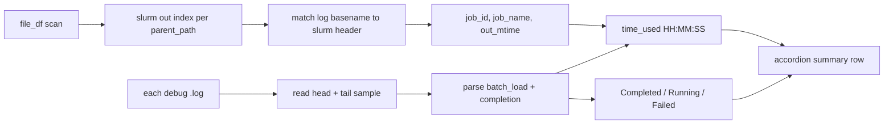

# Per-log Time Used and Status (OOD-style)

## Context

[`show_session_log_browser`](c:\Users\pho\repos\PhoGlobusHelpers\src\phoglobushelpers\gen_scripts_log_status.py) already lists recent `debug_*.log` files in static HTML accordions ([`_build_session_log_browser_html`](c:\Users\pho\repos\PhoGlobusHelpers\src\phoglobushelpers\gen_scripts_log_status.py) ~657–714), but summaries only show filename, parsed qclu/tbin keys, mtime, and size. Session-level status uses file-size heuristics (`classify_session_status`), not per-job Slurm fields.

Your Great Lakes screenshot columns map to data we can derive locally:

| OOD column | Source on synced K: tree |
|------------|---------------------------|
| **ID** | Trailing digits in matched `slurm_*-{jobid}.out` (e.g. `65233372`) |
| **Name** | Middle of `slurm_*.out` basename (e.g. `gor01_..._Clean`) or existing log keys |
| **Status** | Log lines: `finished run: SessionBatchProgress.COMPLETED`, `ALL DONE!`, `Traceback`, `errors:` |
| **Time Used** | Hybrid (your choice): start from log; end = max(log completion time, matched `.out` `last_modified`) |

Verified on [`K:/scratch/gen_scripts/.../debug_*_Clean.log`](K:/scratch/gen_scripts/run_kdiba_gor01_one_2006-6-08_14-26-15/debug_2026-11-02_11-11-22.gl3223.arc-ts.umich.edu.kdiba.gor01.one.2006-6-08_14-26-15._withNormalComputedReplays-qclu_1246789-frateThresh_2.0_tbin_25ms_Clean.log): `[TIMING START] batch_load_session @ 2026-11-02T11:50:22`, completion at `2026-11-02 12:58:11`, `SessionBatchProgress.COMPLETED`. Matching [`slurm_...-65233372.out`](K:/scratch/gen_scripts/run_kdiba_gor01_one_2006-6-08_14-26-15/slurm_gor01_2006-6-08_14-26-15_q1246789_fr_2_tbin_25ms_Clean-65233372.out) references the same debug log in its header (`full_logger_string` / `final_log_file_path`). Local `.out` bodies are short stubs (no `sacct`/`Elapsed` text), so exact Slurm billing time still may differ by a few minutes from log-only wall clock; using `.out` mtime as an optional later end anchor aligns better with scheduler end.

## Implementation ([`gen_scripts_log_status.py`](c:\Users\pho\repos\PhoGlobusHelpers\src\phoglobushelpers\gen_scripts_log_status.py))

### 1. Slurm companion index (from `file_df`, not full file reads)

- Add `_SLURM_JOB_ID_RE = re.compile(r"-(\d+)\.out$", re.I)` and helpers:
  - `_slurm_job_id_from_name(name) -> Optional[str]`
  - `_slurm_display_name_from_name(name) -> Optional[str]` (strip `slurm_` prefix and `-{id}.out`)
- Add `build_slurm_out_lookup(file_df) -> dict[str, dict[str, dict]]` keyed by `parent_path`, then by **log match key**:
  - Primary key: debug log basename without `.log` (e.g. `debug_2026-11-02_11-11-22.gl3223...Clean`)
  - Build by reading only the first ~4KB of each `slurm_*.out` under that session and extracting `debug_...log` or `full_logger_string="..."` from the header (same pattern already visible in synced stubs).
  - Store: `job_id`, `job_name`, `out_path`, `out_mtime` (from `file_df.last_modified`), `out_size`.

### 2. Log text parser (head + tail for performance)

- Add `parse_debug_log_job_info(log_text: str, *, log_name: str, log_mtime, slurm_info: Optional[dict], now: datetime) -> dict` returning:
  - `job_id`, `job_name` (from slurm lookup when present)
  - `job_status`: `Completed` | `Running` | `Failed` | `Unknown`
    - **Completed**: `SessionBatchProgress.COMPLETED` or standalone `ALL DONE!` without failure markers
    - **Failed**: `Traceback`, `SessionBatchProgress.FAILED`, or `errors:` not `None` near completion
    - **Running**: no completion markers and (optional) log still growing / mtime within `_RUNNING_AGE_HOURS`
  - `time_used_seconds`, `time_used` (`HH:MM:SS`)
- **Start time**: first `[TIMING START] batch_load_session @ {ISO}` in text (regex).
- **Log end time**: latest timestamp among:
  - ISO/`YYYY-MM-DD HH:MM:SS` on lines near `ALL DONE` / `finished run: SessionBatchProgress`
  - fallback: `log_mtime` if completed but no parseable line timestamp
- **Hybrid end (your choice)** when `slurm_info` matched and `out_mtime > start`:
  - `end = max(log_end, out_mtime)` (timezone-normalize both to UTC)
  - `duration = end - start` (clamp at 0)
- **Running jobs**: `end = now` (or `log_mtime` if newer), status `Running`, duration shown as elapsed so far.
- Add `_format_duration_hms(seconds) -> str` for OOD-style `HH:MM:SS`.

### 3. Wire into browser + optional DataFrame enrichment

- Change `_build_session_log_browser_html(recent_logs, status_df, n_tail_lines, file_df)` (add `file_df` parameter).
- Precompute `slurm_lookup = build_slurm_out_lookup(file_df)` once per render.
- In the per-log loop (~657): after reading `full_text`, call `parse_debug_log_job_info(...)` with matched slurm row; inject into accordion summary:
  - New line under `.log-summary-keys`, e.g. **`65233372 · gor01_..._Clean · Completed · 01:10:14`** (reuse `.tok-ok` / `.tok-error` for status coloring via small CSS classes `.job-status-completed`, `.job-status-running`, `.job-status-failed`).
- Update `show_session_log_browser` to pass `file_df` into `_build_session_log_browser_html`.
- Optional small enhancement: add columns on returned `status_df` only for the **newest** log per session (`job_id`, `job_status`, `time_used`) by reusing the same parser on `log_path` — keeps notebook table useful without a second API.

### 4. Tests (lightweight, no K: dependency)

- Add [`tests/test_gen_scripts_log_status_job_parse.py`](c:\Users\pho\repos\PhoGlobusHelpers\tests\test_gen_scripts_log_status_job_parse.py) with inline snippets mirroring Clean/Continued/Figure patterns:
  - job ID extraction from slurm filename
  - Completed + duration from batch_load → ALL DONE timestamps
  - hybrid end when `out_mtime` is later than log end
  - Failed on Traceback

## Out of scope

- Live `sacct` / Open OnDemand API calls (would need cluster credentials).
- Parsing full Slurm accounting from `.out` until pipeline writes `Elapsed` there.

## Validation

- Re-run notebook cell calling `show_session_log_browser(...)` on `K:/scratch/gen_scripts` and confirm each accordion shows **job ID**, **Completed/Running/Failed**, and **Time Used** for jobs in your screenshot (e.g. `65233372` Clean, `65233373` Continued).
- Spot-check Clean job: duration should move closer to ~`01:10` vs log-only ~`01:08` once `.out` mtime is used as end anchor.
