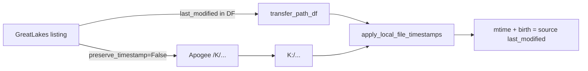

# Avoid preserve_timestamp failures; set mtimes post-hoc

## Problem

Recent wiring of Globus `preserve_timestamp=True` (default in [`PhoGlobusHelper.py`](c:/Users/pho/repos/PhoGlobusHelpers/src/phoglobushelpers/PhoGlobusHelper.py) `batch_transfer_files` / `perform_copy_files`) causes transfers to fail with *"This server version does not support timestamp preservation"* when either endpoint lacks the feature. Transfers abort instead of completing with copy-time mtimes.

## Approach (chosen)

Do **not** ask Globus to preserve timestamps. Transfers succeed; then set correct mtimes (and Windows creation time) locally from the listing’s `last_modified`, which `perform_copy_files` already returns on the path DataFrame.



Infrastructure already exists — no new timestamp logic:

- [`path_helpers.apply_local_file_timestamps`](c:/Users/pho/repos/PhoGlobusHelpers/src/phoglobushelpers/path_helpers.py) — `os.utime` + optional `win32_setctime`; maps `/K/...` to `K:/...`; skips missing files (safe for async)
- [`GlobusConnector.apply_local_file_timestamps`](c:/Users/pho/repos/PhoGlobusHelpers/src/phoglobushelpers/PhoGlobusHelper.py) — thin wrapper
- Notebook cell already has the call **commented out** near gen_scripts

## Code changes

### 1. Flip default to False in PhoGlobusHelper.py

In both `batch_transfer_files` and `perform_copy_files`:

- Change `preserve_timestamp: bool = True` to `preserve_timestamp: bool = False`
- Update docstrings: Globus preserve is opt-in only when both servers support it; preferred path for Apogee is post-hoc `apply_local_file_timestamps`
- When `synchronous_wait=True`, after a successful wait, automatically call `apply_local_file_timestamps(path_df)` so sync callers get correct mtimes without a second step (async still requires an explicit post-completion call)

### 2. Notebook: disable Globus preserve + enable post-hoc

In [`greatlakes_file_transfers_notebook.ipynb`](c:/Users/pho/repos/PhoGlobusHelpers/notebooks/greatlakes_file_transfers_notebook.ipynb):

**gen_scripts transfer cell** — pass `preserve_timestamp=False` explicitly:

```python
transfer_path_df = connect_man.perform_copy_files(
    active_file_df=active_file_df,
    transfer=gen_scripts_GL_to_Apogee,
    synchronous_wait=False,
    preserve_timestamp=False,
)
```

**Post-transfer cell** — uncomment and fix the comment so it is the primary timestamp path:

```python
# After GL->Apogee transfer completes (files on K:):
connect_man.apply_local_file_timestamps(transfer_path_df)
```

**collected_outputs / temp_individual_posteriors cells** — same pattern: capture `transfer_path_df = ...`, `preserve_timestamp=False`, and an adjacent post-hoc apply cell for when those transfers finish.

Keep `show_session_log_browser(..., most_recent_only_log_file_df=...)` as a display fallback if FS apply was skipped or transfer is still in flight (`apply_remote_mtime_overrides` does not write the FS).

### 3. Docs / comments only

- Update the misleading notebook comment that says Globus preserve already sets mtime
- Leave `scripts/python_globus_testing.ipynb` alone unless you hit the same error there

## Scope limits

- Post-hoc apply only works for **local** dests (Apogee `K:` from this machine). Lab/rMBP dests keep `preserve_timestamp=False` for reliability; mtimes stay copy-time unless you run an applicator on that host.
- No change to transfer batching, sync_level, or listing logic.
- Re-run `apply_local_file_timestamps` after async tasks finish; re-running is idempotent for already-applied files.
