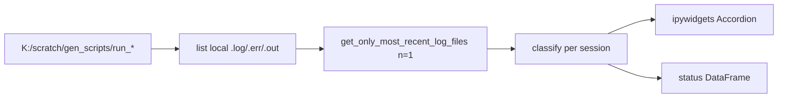

# Per-session latest-log status browser

## Goal
In [`notebooks/greatlakes_file_transfers_notebook.ipynb`](c:\Users\pho\repos\PhoGlobusHelpers\notebooks\greatlakes_file_transfers_notebook.ipynb), after logs land under `K:\scratch\gen_scripts`, show **one card/section per session** with:
- status (`running` / `finished` / `early_or_stuck` / `failed` / `stale`)
- newest `.log` path, size, mtime
- **tail of that single latest log** (not every historical log)

Unlike `LogFilePanel` (which opens tabs for *all* matching logs and requires `pyphoplacecellanalysis`), this stays inside PhoGlobusHelpers and only displays `n_most_recent_files=1` per session.

**UI default:** inline **ipywidgets** Accordion (session name → status + last ~80 lines). No new Panel / pyphoplacecellanalysis dependency. `watchdog` is already in [`pyproject.toml`](c:\Users\pho\repos\PhoGlobusHelpers\pyproject.toml) if we later add live refresh; v1 is refresh-on-rerun.

## Data flow



## Implementation

### 1. New helper module
Add [`src/phoglobushelpers/gen_scripts_log_status.py`](c:\Users\pho\repos\PhoGlobusHelpers\src\phoglobushelpers\gen_scripts_log_status.py):

- `list_local_gen_scripts_files(root: Path) -> pd.DataFrame`  
  Same schema as Globus file df (`type`, `parent_path`, `name`, `last_modified`, `size`) via `run_*/*` scan (reuse the notebook cell logic already present).

- `build_session_status_df(file_df, n_most_recent_files=1) -> pd.DataFrame`  
  Call existing [`get_only_most_recent_log_files`](c:\Users\pho\repos\PhoGlobusHelpers\src\phoglobushelpers\compatibility_objects\Files.py). Pivot one row per `parent_path` with columns like: `session`, `status`, `log_path`, `log_size`, `log_mtime`, `out_size`, `err_size`, `age_hours`.

- `classify_session_status(...)` heuristics (local snapshot only):
  - `.err` non-empty / contains `Traceback` → `failed`
  - newest `slurm_*.out` size ≥ ~1800 → `finished` (Slurm footer present)
  - `.log` size large and mtime within ~1h → `running`
  - `.log` tiny (~&lt;5KB) and age &lt; ~6h → `early_or_stuck`
  - else → `stale`

- `read_log_tail(path, n_lines=80) -> str`

- `show_session_log_browser(root=..., n_tail_lines=80)`  
  Build status df, display it, then Accordion: title `[{status}] {session}` → HTML/Text of log tail. Only sessions that have a latest `.log`.

Keep `ipywidgets` import inside `show_session_log_browser` so non-notebook callers can use the DataFrame helpers without widgets.

### 2. Notebook cleanup / wiring
In [`greatlakes_file_transfers_notebook.ipynb`](c:\Users\pho\repos\PhoGlobusHelpers\notebooks\greatlakes_file_transfers_notebook.ipynb):

- Replace the sketch markdown cell (“Perhaps inspired by that widget…”) with a short “Browse local latest logs” section.
- Replace the ad-hoc local listing cell + the failing `LogFilePanel` import cell with:

```python
from phoglobushelpers.gen_scripts_log_status import show_session_log_browser
show_session_log_browser(Path(r"K:/scratch/gen_scripts"))
```

Place this **after** the GL→Apogee `perform_copy_files` cell so K: is populated.

### 3. Out of scope (v1)
- Live `watchdog` auto-refresh (can add later; rerun cell is enough).
- Slurm `squeue` / Globus remote status (local heuristics only; note that K: is a sync snapshot).
- Showing historical logs beyond the newest `.log` / companion `.out`/`.err` used for status.
