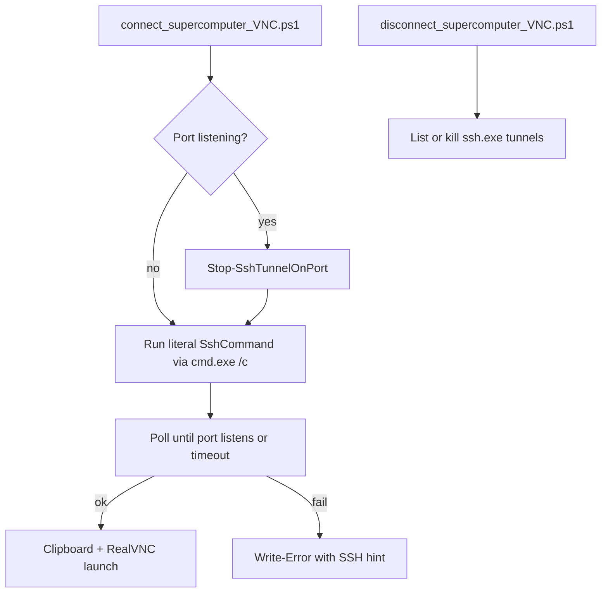

# SSH CMD Execution and Tunnel Lifecycle

## Problem diagnosis

The current [`connect_supercomputer_VNC.ps1`](c:\Users\pho\repos\PhoWindowsHelpers\scripts\connect_supercomputer_VNC.ps1) reports success even when the tunnel never comes up:

```32:33:c:\Users\pho\repos\PhoWindowsHelpers\scripts\connect_supercomputer_VNC.ps1
    Start-Process ssh -ArgumentList @("-N", "-L", "${LocalPort}:${remoteHost}:${remotePort}", "${username}@${gateway}") -WindowStyle Hidden
    Start-Sleep -Seconds 2
```

Issues:
- **Rewrites the command** — drops `-f` and rebuilds args via `Start-Process ssh`, which differs from your working manual CMD workflow.
- **No verification** — fixed 2s sleep, no check that `LocalPort` is actually listening.
- **Silent failure** — `WindowStyle Hidden` hides auth/connection errors.
- **Stale tunnels** — if port is already in use, it skips tunnel start entirely (line 28–29), which may leave a dead or wrong tunnel in place.

## Architecture



## 1. Run literal SSH command in CMD.exe

Replace the reconstructed `Start-Process ssh ...` block with:

```powershell
Start-Process cmd.exe -ArgumentList @("/c", $SshCommand) -WindowStyle Hidden
```

- Uses the **exact** string extracted from OOD (including `-f -N -L ...`).
- Matches your manual workflow that works in CMD but not PowerShell paste.
- Keep the existing regex parse only for logging/teardown (port, gateway, remote host) — not for building the SSH invocation.

Optional `-ShowSshWindow` switch (default `$false`) to use `-WindowStyle Normal` for debugging auth failures.

## 2. Verify tunnel readiness

Add `Wait-SshTunnelReady -LocalPort -TimeoutSeconds 15`:

- Poll every 500ms: `Get-NetTCPConnection -LocalPort $LocalPort -State Listen`
- On success: continue to VNC launch.
- On timeout: `Write-Error` with message to run `$SshCommand` manually in CMD and check SSH key auth / VPN.

Remove the blind `Start-Sleep -Seconds 2`.

## 3. Auto-replace stale tunnels (your preference)

Add `Stop-SshTunnelOnPort -LocalPort`:

```powershell
$conn = Get-NetTCPConnection -LocalPort $LocalPort -State Listen -ErrorAction SilentlyContinue
if ($conn) { Stop-Process -Id $conn.OwningProcess -Force -ErrorAction SilentlyContinue; Start-Sleep -Seconds 1 }
```

Call this **before** starting a new tunnel (always, not only when skipping). This replaces the current "skip if listening" logic.

## 4. New disconnect script for manual lifecycle

Create [`scripts/disconnect_supercomputer_VNC.ps1`](c:\Users\pho\repos\PhoWindowsHelpers\scripts\disconnect_supercomputer_VNC.ps1):

| Parameter | Behavior |
|-----------|----------|
| `-LocalPort <int>` | Kill the `ssh.exe` process owning that listening port |
| `-AllGreatLakes` | Kill all `ssh.exe` processes whose command line matches `-L \d+:.+\.arc-ts\.umich\.edu:\d+` |
| (none) | List active tunnel ports + owning PIDs (no kill) |

Example usage after implementation:

```powershell
# List active tunnels
.\scripts\disconnect_supercomputer_VNC.ps1

# Kill tunnel on port 22587
.\scripts\disconnect_supercomputer_VNC.ps1 -LocalPort 22587

# Kill all Great Lakes VNC tunnels
.\scripts\disconnect_supercomputer_VNC.ps1 -AllGreatLakes
```

Shared helper functions (`Stop-SshTunnelOnPort`, `Get-SshTunnelProcesses`) can live at the top of `connect_supercomputer_VNC.ps1` and be dot-sourced by the disconnect script to avoid duplication.

## 5. Manual lifecycle reference (for notes / script output)

When automation is not enough:

| Action | Command |
|--------|---------|
| See listeners | `Get-NetTCPConnection -State Listen \| Where-Object LocalPort -gt 1024` |
| Find ssh for a port | `Get-NetTCPConnection -LocalPort 22587 -State Listen \| Select OwningProcess` |
| Kill by PID | `Stop-Process -Id <pid> -Force` |
| Kill all ssh tunnels | `Get-Process ssh -ErrorAction SilentlyContinue \| Stop-Process -Force` |

Tunnels die when the `ssh.exe` process exits (session ends, laptop sleep, gateway disconnect). They do **not** auto-clean when the OOD VNC session ends on the cluster side.

## Files changed

- [`scripts/connect_supercomputer_VNC.ps1`](c:\Users\pho\repos\PhoWindowsHelpers\scripts\connect_supercomputer_VNC.ps1) — CMD literal SSH, verify ready, auto-kill on port
- [`scripts/disconnect_supercomputer_VNC.ps1`](c:\Users\pho\repos\PhoWindowsHelpers\scripts\disconnect_supercomputer_VNC.ps1) — new teardown/list script

No changes needed to [`extract_supercomputer_VNC_info.py`](c:\Users\pho\repos\PhoWindowsHelpers\scripts\extract_supercomputer_VNC_info.py); it already passes the full `-SshCommand` string.

## Test plan

1. Run connect with embedded HTML session — confirm CMD launches, port 22587 shows `Listen`, RealVNC opens.
2. Run connect again — confirm old tunnel is killed and replaced.
3. Run `disconnect_supercomputer_VNC.ps1 -LocalPort 22587` — confirm port no longer listening.
4. Simulate failure (wrong gateway in test) — confirm timeout error instead of silent success.
