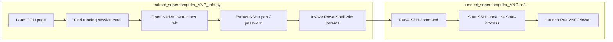

# VNC Extract and Connect Pipeline

## Current state

- [`extract_supercomputer_VNC_info.py`](c:\Users\pho\repos\PhoWindowsHelpers\scripts\extract_supercomputer_VNC_info.py) loads embedded OOD HTML via Playwright, clicks the Native Instructions tab, and only prints the password using a brittle xpath (`contains(text(), 'rD')`).
- [`connect_supercomputer_VNC.ps1`](c:\Users\pho\repos\PhoWindowsHelpers\scripts\connect_supercomputer_VNC.ps1) parses a hardcoded text block with regex and displays results — it does not accept parameters or connect.

Target data lives in the **running** session card under Native Instructions (example from embedded HTML):

```553:561:c:\Users\pho\repos\PhoWindowsHelpers\scripts\extract_supercomputer_VNC_info.py
    <pre><code>ssh -f -N -L 22587:gl3039.arc-ts.umich.edu:5901 halechr@greatlakes.arc-ts.umich.edu</code></pre>
    ...
    <code>localhost:22587</code>
    ...
    <p>Use the VNC password: <code>rD35cTzZ</code></p>
```

## Architecture



## 1. Python: robust extraction

Refactor the bottom of [`extract_supercomputer_VNC_info.py`](c:\Users\pho\repos\PhoWindowsHelpers\scripts\extract_supercomputer_VNC_info.py):

- Add `extract_vnc_info(page) -> dict` returning `{ssh_command, local_port, vnc_password}`.
- Scope to the **running** session only:
  - `running_card = page.locator('[data-status="running"]').first`
  - Click Native Instructions tab **within that card**: `running_card.locator('a[href*="_1"]').click()`
  - Disable hash-change polling on that card (keep existing `onhashchange` / `pollInterval` guard).
- Extract from the native tab pane (`div[id$="_1"]` scoped to running card):
  - **SSH command**: text of `pre code` (strip whitespace)
  - **Local port**: regex on SSH command `-L (\d+):` (primary); cross-check against `localhost:(\d+)` in tab text
  - **Password**: regex `Use the VNC password:\s*(\S+)` or inner text of the password `<code>` element
- Validate all three fields; raise a clear error if no running session or parse failure.
- Remove the hardcoded `rD` xpath and the debug-only `print`.

## 2. Python: invoke PowerShell

After extraction, call the connect script via `subprocess`:

```python
subprocess.run(["powershell.exe", "-NoProfile", "-ExecutionPolicy", "Bypass", "-File", str(ps_script), "-SshCommand", info["ssh_command"], "-LocalPort", str(info["local_port"]), "-VncPassword", info["vnc_password"]], check=True)
```

- Resolve `ps_script` relative to `Path(__file__).parent`.
- Add `if __name__ == "__main__":` guard so the script is runnable standalone.

## 3. PowerShell: parameterized connect script

Rewrite [`connect_supercomputer_VNC.ps1`](c:\Users\pho\repos\PhoWindowsHelpers\scripts\connect_supercomputer_VNC.ps1) with a `param()` block:

| Parameter | Purpose |
|-----------|---------|
| `-SshCommand` | Full OOD SSH string |
| `-LocalPort` | Local tunnel port (e.g. 22587) |
| `-VncPassword` | VNC password |
| `-VncViewerPath` | Optional; default `C:\Program Files\RealVNC\VNC Viewer\vncviewer.exe` |

**SSH tunnel (Windows-adapted):**
- Reuse existing regex to parse `LocalPort`, `RemoteHost`, `RemotePort`, `Username`, `Gateway` from `-SshCommand`.
- Drop `-f` (Unix background flag; unreliable on Windows OpenSSH).
- Start tunnel in background:

```powershell
Start-Process ssh -ArgumentList @("-N", "-L", "${LocalPort}:${RemoteHost}:${RemotePort}", "${Username}@${Gateway}") -WindowStyle Hidden
```

- Optionally skip tunnel start if `Get-NetTCPConnection -LocalPort $LocalPort` already shows a listener (avoid duplicate tunnels).

**Launch RealVNC:**
- Verify `$VncViewerPath` exists; error with install link if missing.
- Brief sleep (~2s) after tunnel start.
- Launch viewer:

```powershell
Start-Process $VncViewerPath -ArgumentList @("-Password", $VncPassword, "localhost:$LocalPort")
```

- Print a short status summary (tunnel port, viewer launched).

Remove the hardcoded `$text` here-string; keep regex patterns as the parser for `-SshCommand`.

## 4. Edge cases and assumptions

- **RealVNC installed** at default path; overridable via `-VncViewerPath`.
- **SSH key auth** already configured (per [`2026-01-21_PasswordlessSSH.md`](c:\Users\pho\repos\PhoWindowsHelpers\notes\2026-01-21_PasswordlessSSH.md)); tunnel start will fail visibly if not.
- **Embedded HTML vs live page**: extraction logic targets stable DOM attributes (`data-status`, tab href suffix `_1`, `pre code`). Swapping embedded HTML for a live Playwright navigation later is a one-line change upstream of `extract_vnc_info`.
- **Password on CLI**: visible in process list briefly; acceptable for local automation. No file writes needed.

## Files changed

- [`scripts/extract_supercomputer_VNC_info.py`](c:\Users\pho\repos\PhoWindowsHelpers\scripts\extract_supercomputer_VNC_info.py) — extraction function + PS invocation
- [`scripts/connect_supercomputer_VNC.ps1`](c:\Users\pho\repos\PhoWindowsHelpers\scripts\connect_supercomputer_VNC.ps1) — params, tunnel, RealVNC launch

No new dependencies; Playwright is already in [`pyproject.toml`](c:\Users\pho\repos\PhoWindowsHelpers\pyproject.toml).

## Manual test plan

1. Run `uv run python scripts/extract_supercomputer_VNC_info.py` with current embedded HTML (running session present).
2. Confirm Python prints/extracts: SSH command `22587`, password `rD35cTzZ`.
3. Confirm PowerShell starts `ssh` listener on port 22587 and opens RealVNC to `localhost:22587`.
4. Re-run with no running session in HTML to confirm clear error message.
